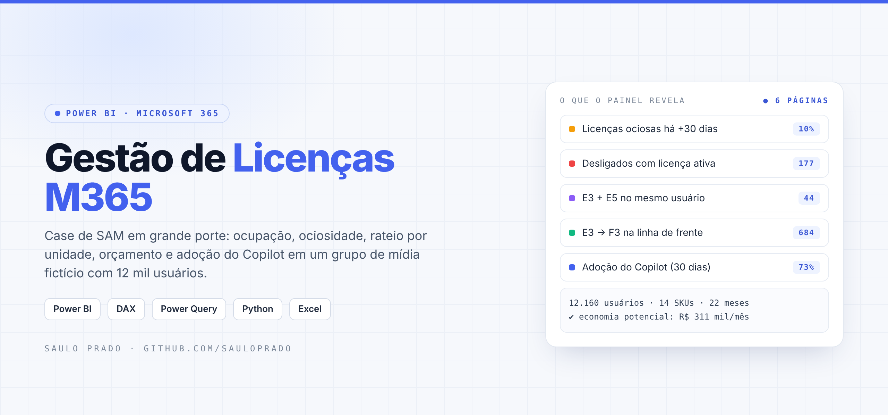
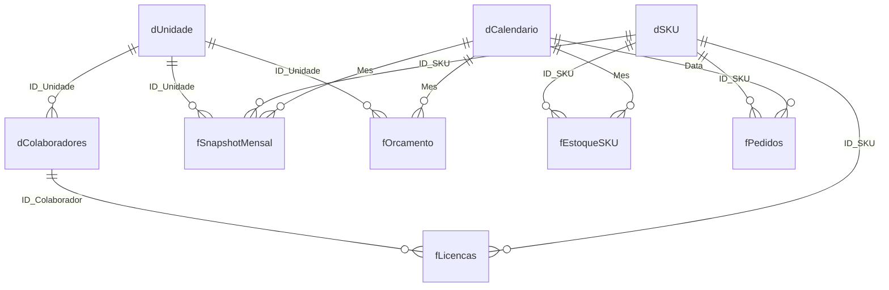

<p align="center">
  
</p>

<p align="center">
  
  
  
  
  
</p>

# Gestão de Licenças M365

Case de **Software Asset Management (SAM)** em Power BI: gestão das licenças Microsoft 365 de um grupo de mídia com **12 mil usuários**, com ocupação por SKU, licenças ociosas, rateio por unidade, orçamento e adoção do Copilot.

A empresa, as pessoas e os números são **fictícios**. A base é gerada por um script Python reproduzível, construído a partir de situações reais da rotina de gestão de licenças.

## Sumário

- [O cenário](#o-cenário)
- [O que o painel responde](#o-que-o-painel-responde)
- [Principais achados](#principais-achados)
- [Modelo de dados](#modelo-de-dados)
- [Como usar](#como-usar)
- [Estrutura do repositório](#estrutura-do-repositório)
- [Próximos passos](#próximos-passos)
- [Autor](#autor)

## O cenário

O **Grupo Aurora Mídia** (fictício) tem 8 unidades de negócio — Jornalismo, Produção e Estúdios, Streaming e Digital, Comercial, TV Aberta, Tecnologia, Corporativo e Rádio — e contrata 14 SKUs Microsoft no modelo CSP/NCE: aumento a qualquer momento, redução só na renovação anual.

| Indicador | Valor |
|---|---|
| Usuários e contas de serviço | 12.160 |
| Licenças ativas | 14.928 |
| Custo mensal (out/2026) | R$ 2,18 milhões |
| Período analisado | jan/2025 a out/2026 |

## O que o painel responde

| Página | Pergunta |
|---|---|
| Visão Executiva | Quanto custa, quanto dá para economizar e se estamos dentro do orçamento |
| Ocupação por SKU | Onde falta licença e onde sobra |
| Otimização | O que remover ou rebaixar, e de quem |
| Copilot | Se o piloto está sendo usado de fato |
| Rateio e Orçamento | Quanto cada unidade consome e quanto fugiu do plano |
| Pedidos | Como o estoque foi ajustado ao longo do tempo |

## Principais achados

| Frente | Achado | Ação |
|---|---|---|
| Ociosidade | 10% das licenças sem uso há mais de 30 dias | Remover ou reaproveitar |
| Desligamento | 177 desligados ainda com licença ativa | Integrar o desligamento com a remoção automática |
| Sobreposição | 44 usuários com E3 **e** E5 | Remover a E3 após o upgrade |
| Perfil | 684 usuários de linha de frente usando E3 | Migrar para F3 |
| Estoque | Project Plano 3 com 100% de ocupação | Comprar antes de faltar |
| Copilot | 693 licenças, 73% ativas | Expandir onde há adoção |

**Economia potencial: cerca de R$ 311 mil por mês (R$ 3,7 milhões por ano), sem contar duplicidades.**

## Modelo de dados

Esquema estrela com fotografias mensais (semiaditivas) separadas do estado atual por usuário.



| Tabela | Conteúdo |
|---|---|
| `dUnidade` | Unidades, diretoria e headcount |
| `dSKU` | Catálogo de licenças e preço mensal de referência |
| `dColaboradores` | Usuários, persona (Executivo, Conhecimento, Linha de frente), vínculo e status |
| `fLicencas` | Atribuições por usuário, com última atividade |
| `fSnapshotMensal` | Atribuídas e ativas (30 dias) por mês, SKU e unidade |
| `fEstoqueSKU` | Quantidade contratada por SKU e mês |
| `fPedidos` | Aumentos e reduções de licença |
| `fOrcamento` | Orçamento mensal por unidade |

Todas as medidas DAX, os relacionamentos e o roteiro das páginas estão em **[docs/medidas-dax.md](docs/medidas-dax.md)**.

## Como usar

1. Baixe `dados/Licencas_M365_Base.xlsx`.
2. No Power BI Desktop: **Obter dados › Excel** e marque as 8 tabelas.
3. Siga o [guia de modelagem e medidas](docs/medidas-dax.md).

Para gerar a base de novo (ou mudar porte e regras):

```bash
pip install pandas openpyxl python-dateutil
python gerador/gerar_base.py
```

## Estrutura do repositório

```
gestao-licencas-m365/
├── assets/capa.png
├── dados/Licencas_M365_Base.xlsx
├── docs/medidas-dax.md
├── gerador/gerar_base.py
├── LICENSE
└── README.md
```

## Próximos passos

- [ ] Arquivo do relatório (`.pbix`) e prints das 6 páginas
- [ ] Vídeo curto navegando pelo painel
- [ ] Alerta de ocupação via Power Automate

## Autor

**Saulo Prado** · Gestão de Ativos de TI, licenciamento, automação e dashboards
[LinkedIn](https://www.linkedin.com/in/saulo-prado/) · [GitHub](https://github.com/sauloprado)

Licença [MIT](LICENSE).
